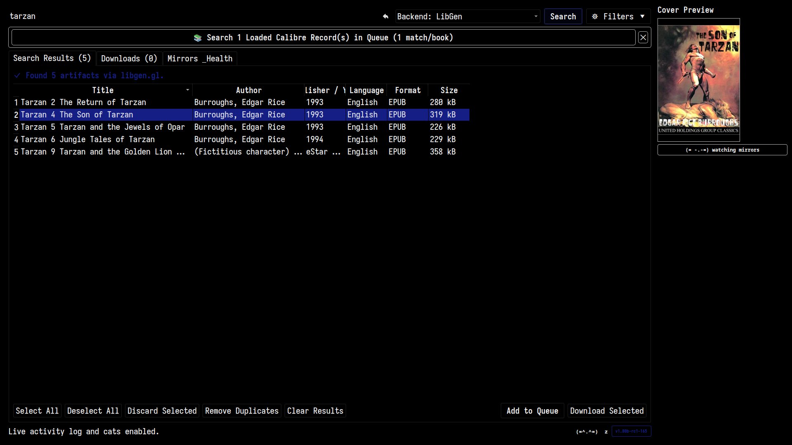

# Calibre LibGen Downloader (`calibre-lib`)

[](https://github.com/7sarus/calibre-lib/releases)
[](https://t.me/devvdump)
[](https://github.com/7sarus/calibre-lib/stargazers)
[](https://github.com/7sarus/calibre-lib/releases)
[](LICENSE)

A Calibre plugin that adds a toolbar button (`Ctrl+Shift+L`) for searching, queueing, and downloading books from Library Genesis directly into your Calibre library.

<p align="center">
  
  <br>
  <em>LibGen Downloader v1.90b "Ducky" running fullscreen in Calibre 9.18 on Arch Linux.</em>
</p>

---

## Features

- **Field-targeted search**: Search across all fields or narrow by title, author, series, publisher, year, or ISBN. Supports LibGen topic filters (fiction, sci-tech, papers, comics, magazines).
- **Format and language filtering**: Prioritize or strictly require target formats (EPUB, PDF, MOBI, AZW3, DJVU) and languages.
- **Mirror benchmarking and failover**: Measures latency and live bandwidth to pick the fastest responsive mirror. Automatically switches mirrors if an active download drops or stalls.
- **Bulk queue**: Select multiple results (`Ctrl+Shift+A` or context menu) and run downloads sequentially in the background while keeping focus in the search box.
- **Staged library import**: Downloads land in a staging directory first. A review dialog lets you inspect files and choose what to import or skip before touching your library.
- **Library shortcuts**: Right-click any book in Calibre to search LibGen for that author.
- **Zero external dependencies**: Uses only Calibre's bundled Python, Qt, and BeautifulSoup.

---

## Installation

### Quick Install (Pre-built Release)

1. Download `libgen_downloader.zip` from the [Latest Release](https://github.com/7sarus/calibre-lib/releases).
2. Open **Calibre**.
3. Go to **Preferences** -> **Plugins** (under *Advanced*).
4. Click **Load plugin from file** and select `libgen_downloader.zip`.
5. Restart Calibre.

### Install from Source (Using Make)

```bash
git clone https://github.com/7sarus/calibre-lib.git
cd calibre-lib
make install
```

---

## Usage

1. Open **Calibre**.
2. Click the **LibGen** button on the main toolbar (or press `Ctrl+Shift+L`).
3. Type your query, choose language/format filters, and press **Search**.
4. Select books and press `Ctrl+Shift+A` (or click **Add to Queue**). Focus stays in the search box to keep queueing.
5. Switch to the **Queue** tab and click **Start Bulk Download** (or click **Download Selected** for an immediate run).
6. Review downloaded files in the import dialog to add them to your Calibre library.

---

## Configuration

In Calibre, go to:
**Preferences** -> **Plugins** -> **User interface action plugins** -> select **LibGen Downloader** -> click **Customize plugin**.

Configure:
- **Primary Mirror URL**: Default `https://libgen.li`.
- **Fallback Mirrors**: Comma-separated list of fallback domains.
- **Connection Timeout**: Network timeout in seconds.
- **Lock / Preferred Language**: Default language preference.
- **Lock / Preferred Format**: Default format preference (EPUB, PDF, etc.).
- **Filter Enforcement**: `Prioritize` or `Strict`.
- **Max Results per Search**: Results count to retrieve.

---

## Development & Testing

- Build the `.zip` package:
  ```bash
  make build
  ```
- Run integration search & module tests in Calibre debug mode:
  ```bash
  make test
  ```
- Uninstall plugin:
  ```bash
  make uninstall
  ```

---

## Star History

[](https://star-history.com/#7sarus/calibre-lib&Date)

---

## Acknowledgements & Notes

- **Upstream origin**: Adapted from [`obsfx/libgen-downloader`](https://github.com/obsfx/libgen-downloader) by Ömercan Balandı, porting mirror scraping and download handling to a native Calibre Qt plugin.
- **LLM-assisted development**: Built with the assistance of an LLM pair programmer.
- **Project status**: An open-source hobby project maintained for personal reading workflows.

## Community & Support

<p align="center">
  <a href="https://t.me/devvdump" target="_blank">
    
  </a>
</p>

Join our community on Telegram: [**t.me/devvdump**](https://t.me/devvdump) for discussions, feature requests, mirror health updates, and bug reports.

---

## Releases & Version History

- **[v1.90b "Ducky" (Beta Release)](https://github.com/7sarus/calibre-lib/releases/tag/v1.90b)**:
  - Fixed silent download and search failures by retiring broken legacy mirrors.
  - Added modular session-isolated CDN tracking and diagnostic clipboard reporting.
  - Streamlined queue interface with hidden debug/easter-egg controls and clean action buttons.
  - Added offline test suite covering UI initialization, mirror selection, and queue operations.
- **[v1.80b-rc1 "Mithrandir" (Beta Release)](https://github.com/7sarus/calibre-lib/releases)**:
  - **Modular Subdialogs**: `CsvImportDialog` and `ReviewImportDialog` extracted to standalone modules; purged 580+ lines from main dialog.
  - **Decoupled Providers**: Bookracy provider operates autonomously with native JSON parsing and direct fallback probing.
  - **Queue Batch Operations**: Efficient $O(N+M)$ queue additions via batch `extend` and atomic removal `remove_indices`.
  - **Resumable Search Queue**: Pausing retains progress and evicts completed records, enabling clean resumption.
  - **Restored Backend Isolation**: Complete separation of LibGen and Bookracy mirror pools and Preferences backend selection.
- **[v1.70b](https://github.com/7sarus/calibre-lib/releases/tag/v1.70b)**:
  - **Bookracy API Backend & Provider**: Secondary book provider querying Bookracy concurrently with LibGen mirrors.
  - **Dual-Stage Failover Recovery**: Automatically recovers failed downloads with exact MD5 matching first, then Title + Author fallback.
  - **"Retry with Bookracy" Queue Action**: Instant queue toolbar button and live fallback toggle for seamless retry workflows.
  - **Isolated Provider Preferences**: Dedicated settings configuration to manage Bookracy credentials and behavior cleanly.
  - **Refactored Modular Architecture**: Modular background workers and queue management for rock-solid stability.
- **[v1.50](https://github.com/7sarus/calibre-lib/releases/tag/v1.50)**:
  - **Hardcover Reading Lists**: Sync "Want to Read" and custom shelves straight into your download queue with automatic duplicate detection.
  - **Search Existing Library Books**: Highlight books in Calibre and batch-search working mirrors without manual typing.
  - **Optimized Download Speeds**: 512 KB streaming buffers, smart connection limits, and automatic Cloudflare 503 bypasses for reliable transfers.
  - **Modernized UI & Live Metrics**: Real-time speed tiers, exact MB transferred, ETA countdowns, and movable tabs.
  - **Instant Mirror Failover**: Automatic fallback to fastest responsive mirrors with live latency indicators.
- **[v1.0.1 "Godzila" (Hotfix)](https://github.com/7sarus/calibre-lib/releases/tag/v1.0.1)**:
  - Fixed silent download and resolution failures across newer mirrors (`.li`, `.vg`, `.la`) due to anti-scraping checks.
  - Smooth animated cover preview text spinner (`⠋ 📖`) while covers load.
  - In-memory cover caching for zero-latency preview switching.
  - Natural cover aspect ratio preservation without image distortion.
  - Persistent queue across dialog sessions and prompt to preserve failed downloads on stop/error.
  - Multi-attribute deduplication using MD5, file size, and title metadata.
  - Prominent version badge in status bar (click 3x to toggle hidden download stats).
- **[v1.0.0 "Godzila"](https://github.com/7sarus/calibre-lib/releases/tag/v1.0.0)**:
  - Animated retro ASCII companion cat (`(=^.^=)`) in status bar reacting to search and download states.
  - Multi-threaded concurrent downloading (up to 3 simultaneous books) with live speed meters.
  - Embedded book cover preview pane for search results and queue.
  - Compact two-row search toolbar layout fitting small displays.
  - Multi-mirror failover and live scrolling activity log.
  - Retro ASCII progress bars inside queue table.
  - Controlled sandbox review modal before importing files into Calibre library.
- **[v0.2.0 "Batarang"](https://github.com/7sarus/calibre-lib/releases/tag/v0.2.0)**:
  - Live mirror bandwidth benchmarking (throughput alongside latency).
  - One-click "Sort by Speed" button with automatic primary mirror reordering.
  - Search field targeting (`Title`, `Author`, `Series`, `Publisher`, `Year`, `ISBN`).
  - Dedicated "Mirrors & Health" table with separate latency and speed columns.
  - Custom mirror add/remove with persistence.
- **[v0.1.0-alpha](https://github.com/7sarus/calibre-lib/releases/tag/v0.1.0-alpha)**:
  - Initial Calibre User Interface Action plugin port with bulk queue and library ingestion.

---

## License

[WTFPL](LICENSE)
